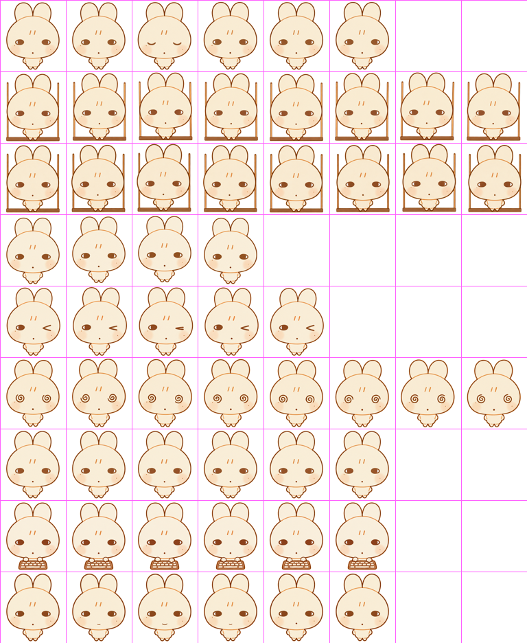
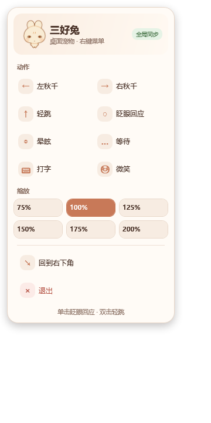

# 三好兔桌面宠物

一个独立的 Windows 桌面宠物程序，使用“三好兔”的 8×9 动画图集制作。

- **当前版本：** `v1.2.0`
- **支持平台：** Windows 10 / 11 x64
- **运行环境：** .NET Framework 4.8
- **发布形式：** 单文件 EXE，不需要安装

## 项目预览

| 动画图集 | 右键菜单 |
| --- | --- |
|  |  |

## 功能特性

- 窗口透明、无边框、始终置顶
- 不显示任务栏按钮
- 动画图集和程序图标已嵌入 EXE
- 支持鼠标拖动、单击、双击和右键菜单
- 支持 75%、100%、125%、150%、175%、200% 缩放
- 支持全 Windows 键盘状态同步
- 支持飞书、微信、Codex/ChatGPT 等聊天软件语义触发
- 不读取、不保存、不上传输入内容
- 无网络请求、无第三方运行时依赖

## 快速开始

1. 下载或克隆本项目。
2. 进入 `dist` 目录。
3. 双击 [`三好兔桌面宠物.exe`](dist/三好兔桌面宠物.exe)。

也可以使用英文文件名：

`dist/SanhaoTuDesktopPet.exe`

> 由于程序暂未进行商业代码签名，Windows SmartScreen 可能在首次运行时显示提示。

## 系统要求

- Windows 10 或 Windows 11
- x64 系统
- .NET Framework 4.8

Windows 10/11 通常已自带 .NET Framework 4.8。如果程序无法启动，请先确认系统已启用该运行时。

## 操作方式

| 操作 | 效果 |
| --- | --- |
| 单击宠物 | 眨眼回应 |
| 双击宠物 | 轻跳 |
| 按住拖动 | 移动宠物；向左拖动播放左秋千，向右拖动播放右秋千 |
| 右键宠物 | 打开操作菜单 |
| 菜单“回到右下角” | 恢复默认位置 |
| 菜单“退出” | 关闭程序 |
| 鼠标停留 2 秒 | 微笑 |
| 按 `Esc` | 眨眼回应 |

### 右键菜单

右键菜单包含：

- 左秋千、右秋千
- 轻跳、眨眼回应
- 晕眩、等待
- 打字、微笑
- 六档缩放
- 回到右下角
- 退出

菜单右上角的状态标识：

- 绿色“全局同步”：全局键盘钩子安装成功
- 红色“同步不可用”：系统或安全软件阻止了键盘钩子

## 动画状态与触发规则

| 行 | 动画名称 | 程序状态 | 触发条件 |
|---:|---|---|---|
| 0 | 眨眼 | `idle` | 默认状态；停止输入 1.2 秒后恢复 |
| 1 | 右秋千 | `swing-right` | 向右拖动宠物 |
| 2 | 左秋千 | `swing-left` | 向左拖动宠物 |
| 3 | 轻跳 | `hop` | 双击宠物；聊天软件按 `Enter` 或 `Ctrl+Enter` 发送 |
| 4 | 眨眼回应 | `wink` | 单击宠物；按 `Esc`；聊天软件按 `Ctrl+C` |
| 5 | 晕眩 | `dizzy` | 全局按 `Delete` 或 `Backspace` |
| 6 | 等待 | `waiting` | 聊天软件发送消息后进入，最多等待 8 秒 |
| 7 | 打字 | `typing` | Windows 全局收到字符、数字、标点、空格、回车或中文输入法按键 |
| 8 | 微笑 | `smile` | 等待后重新输入；聊天软件粘贴；连续输入结束；鼠标停留 2 秒 |

### 推荐交互链路

1. 在聊天软件中按 `Enter`：先播放“轻跳”。
2. 轻跳结束：进入“等待”，最多持续 8 秒。
3. 再次开始输入：先播放“微笑”，随后进入“打字”。
4. 连续 1.2 秒没有输入：恢复“眨眼/待机”。
5. 按 `Backspace` 或 `Delete`：立即进入“晕眩”。

### 状态优先级

```text
晕眩 > 手动点击/拖动 > 打字 > 等待/微笑 > 待机
```

## 全局键盘同步

普通打字和删除在整个 Windows 全局生效。以下应用中的输入都会触发：

- 飞书、Lark
- 微信、企业微信
- 钉钉
- Codex / ChatGPT
- Telegram、Discord、Slack
- QQ、TIM
- 浏览器、Office、终端等其他 Windows 应用

其中 `Enter`、`Ctrl+C`、`Ctrl+V` 等语义动作仅在聊天软件前台时触发，避免在 Excel、IDE 或终端中误触。

### 键盘规则

- 普通字符、数字、标点、空格：进入“打字”
- `Enter`：聊天软件中触发发送链路，其他应用按普通输入处理
- 中文输入法 `VK_PROCESSKEY`：进入“打字”
- 连续输入 8 个按键后停止：微笑一次
- `Backspace` / `Delete`：立即进入“晕眩”
- `Shift+Enter`：视为换行，不触发发送动作
- `Ctrl+C` / `Ctrl+V`：仅在聊天软件中触发对应动画
- `Ctrl`、`Alt`、`Win` 普通快捷键不会误触发打字动画

### 隐私说明

程序使用 Windows 低层键盘钩子 `WH_KEYBOARD_LL` 判断按键类型，但：

- 不读取输入框内容
- 不记录按键序列
- 不保存剪贴板内容
- 不发送任何网络请求
- 程序退出时会卸载全局键盘钩子

## 从源码构建

构建脚本使用 Windows 自带的 .NET Framework C# 编译器，不需要安装 .NET SDK。

```powershell
powershell -NoProfile -ExecutionPolicy Bypass -File .\build.ps1
```

构建完成后生成：

- `dist/SanhaoTuDesktopPet.exe`
- `dist/三好兔桌面宠物.exe`

### 文件被占用

如果构建时正式 EXE 正在运行，Windows 无法覆盖该文件。构建脚本会自动生成：

`dist/三好兔桌面宠物-新版.exe`

关闭正在运行的旧版后重新构建，即可恢复正式中文文件名。

## 项目结构

```text
SanhaoTuDesktopPet/
├─ Program.cs                  # WPF 主程序、动画状态机和键盘钩子
├─ build.ps1                   # 单文件 EXE 构建脚本
├─ README.md
├─ assets/
│  ├─ app.ico                  # EXE 图标
│  └─ spritesheet.png          # 嵌入 EXE 的动画图集
├─ dist/
│  ├─ 三好兔桌面宠物.exe        # 正式中文版
│  └─ SanhaoTuDesktopPet.exe   # 正式英文版
├─ menu-preview.png            # README 菜单预览
└─ preview-grid.png            # README 图集预览
```

> `dist` 目录中可能保留开发过程中的历史版本。正式使用和发布时，请以 `三好兔桌面宠物.exe` 或 `SanhaoTuDesktopPet.exe` 为准。

## 相关文件

本项目复用“三好兔”的 `spritesheet.webp` 动画图集，并在构建时将其转换为内嵌 PNG。源码构建只需要 `assets/spritesheet.png`，不需要额外的原始 WebP 文件。

## 技术说明

- 使用 C# 和 WPF 实现透明无边框窗口
- 使用 `Topmost` 保持始终置顶
- 使用 `DispatcherTimer` 驱动精灵帧动画
- 使用裁剪后的 `CroppedBitmap` 播放 192×208 图集单元
- 使用 `Popup` 实现自定义右键菜单，避免系统菜单蓝色高亮
- 使用 `WH_KEYBOARD_LL` 实现全局键盘状态同步
- 使用前台窗口进程名白名单识别聊天软件
- 使用 `build.ps1` 将 PNG 图集和 ICO 图标嵌入单文件 EXE

## 已知限制

- 不支持锁屏界面、UAC 安全桌面和部分受保护的系统窗口
- 某些安全软件可能阻止全局键盘钩子
- 聊天语义触发依赖进程名白名单；未知软件仍支持基础打字和删除动画
- “回答完成”等深层状态目前通过输入行为推断，不直接读取 Codex 或聊天软件内容
- 全屏独占游戏中的输入同步不做保证

## 常见问题

### 打字没有触发

1. 确认运行的是最新版 `三好兔桌面宠物.exe`。
2. 右键菜单右上角应显示绿色“全局同步”。
3. 如果显示“同步不可用”，请检查安全软件或系统权限。
4. 完全退出旧版后，再启动最新版。

### 飞书、微信等软件中某些动作不触发

普通打字和删除应当始终全局生效。`Enter`、`Ctrl+C`、`Ctrl+V` 等语义动作仅对支持的聊天软件进程名生效。

### 宠物一直处于打字状态

停止输入超过 1.2 秒后会自动恢复。如果持续异常，请退出并重新启动最新版。

### 截图或远程桌面中不触发

部分远程桌面、虚拟键盘、密码安全输入框和受保护窗口不会提供普通键盘事件，这是 Windows 安全机制导致的。

## 更新记录

### v1.2.0

- 改为全 Windows 键盘同步
- 新增聊天软件 `Enter`、复制、粘贴语义触发
- 新增“轻跳 → 等待 → 微笑 → 打字”状态链路
- 新增长输入结束和鼠标停留微笑
- 新增聊天软件进程白名单

### v1.1.0

- 新增全局打字和删除键同步
- `Backspace`、`Delete` 触发晕眩
- 停止输入 1.2 秒恢复待机

### v1.0.1

- 重做右键菜单样式
- 新增 75% 至 200% 缩放
- 修正图集状态名称和动作映射
- 修复系统菜单蓝色高亮框和菜单不显示问题

### v1.0.0

- 首个独立 Windows 桌面宠物版本
- 透明无边框、始终置顶
- 支持动画播放、拖动和基础右键菜单